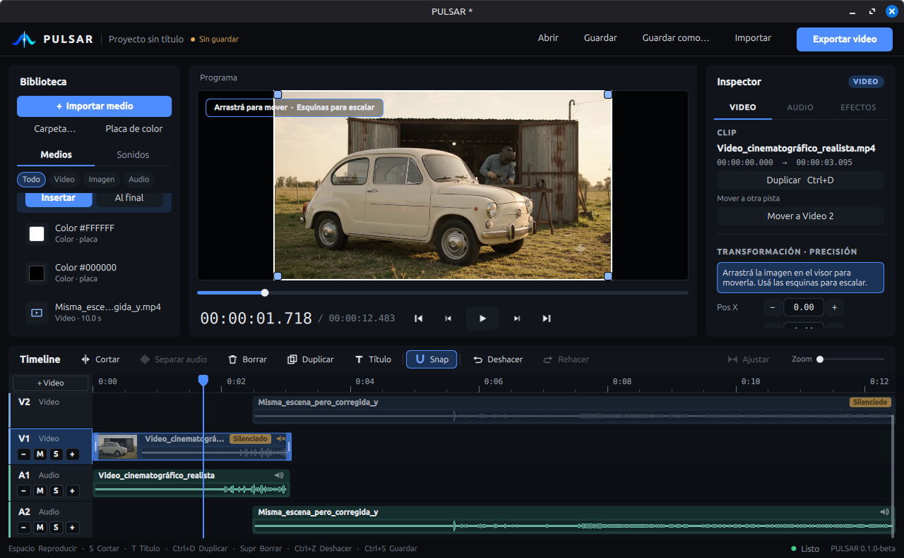

<div align="center">


# PULSAR

**Native, lightweight video editor for predictable editing.**

[](CHANGELOG.md)
[](#-requirements)
[](LICENSE)
[](#-build-from-source)

[**Download**](../../releases) · [Release notes](docs/release/0.2.0-beta.1.md) · [Report a bug](../../issues/new/choose) · [Roadmap](docs/release/roadmap.md) · [🇪🇸 Español](README.es.md)

<br>



</div>

> [!NOTE]
> **First public beta.** Expect rough edges and keep backups of your media and projects.
> The interface is currently **in Spanish**; the README is available in English and Spanish.

PULSAR is a native desktop video editor written in C++ with Qt 6 and FFmpeg. It aims
at a small, predictable editing workflow: **exact timing, no surprises on undo, and an
export you can trust.**

## ✨ Highlights

| | |
|---|---|
| 🎞️ **Multi-track timeline** | Insert at the playhead or add to end (gapless), split, trim, move with magnetic snapping, duplicate, undo / redo, frame step |
| 🖼️ **Direct Viewer editing** | Move and scale clips right on the preview, picture-in-picture, *Ajustar* / *100%* modes |
| 🔤 **Titles** | Static text on its own track, optional background box and opacity, identical in preview and export |
| 🔊 **Audio** | Detach audio, per-clip and per-track gain / mute / solo, fades, waveforms, 37 original built-in sound effects with audition |
| 🗂️ **Media bin** | Filters and search, multi-file and folder import, drag and drop onto the timeline |
| 💾 **Safe projects** | Atomic saves of `.pulsar` projects, autosave and crash recovery |
| 📤 **Export** | H.264 / AAC MP4 with Original / 1080p / 720p presets; refuses to overwrite media the project uses |
| 🎯 **Preview = export** | Both use the same composition plan, so what you see is what you export |

Also: PNG / JPEG / WebP images and colour cards as clips, and a cross-dissolve transition.

## 📦 Requirements

- Linux **x86_64** with **glibc 2.39 or newer** (built and tested on Ubuntu 24.04; Linux Mint 22 and recent Fedora should qualify). **Ubuntu 22.04, Linux Mint 21 and Debian 12 are too old** and fail with `GLIBC_2.39 not found`.
- An X11 or Wayland desktop session with working graphics drivers and audio output.
- The **AppImage** needs FUSE 2 (`libfuse2`; `libfuse2t64` on Ubuntu 24.04). Without it, run with `--appimage-extract-and-run`.
- No Qt or FFmpeg installation needed: both are bundled.

## 🚀 Quick start

Download the files and `SHA256SUMS` from the [Releases page](../../releases) and verify with `sha256sum -c SHA256SUMS`.

```sh
# tar.gz (recommended)
tar xzf PULSAR-0.2.0-beta.1-linux-x86_64.tar.gz
./PULSAR-0.2.0-beta.1/pulsar

# or AppImage
chmod +x PULSAR-0.2.0-beta.1-x86_64.AppImage
./PULSAR-0.2.0-beta.1-x86_64.AppImage     # add --appimage-extract-and-run without FUSE
```

`--version` prints `PULSAR 0.2.0-beta.1`. The bundle ships its own FFmpeg, so avoid opening media from untrusted sources during the beta.

## ⚠️ Known limitations

- **Linux x86_64 only.** No Windows, macOS or mobile builds.
- **Spanish-only interface**; the *Abrir proyecto* file picker is the toolkit's own (light, English).
- **Preview can be slow** with transformed or multi-layer composition (CPU only, no GPU or proxies). Export is authoritative. Not tested with 4K / HEVC / long footage.
- No animated titles, subtitles, keyframes, masks, colour tools or speed control; cross dissolve is the only transition.
- No audio limiter or meters: summing several loud tracks can clip.
- No relink UI for missing media, recent-projects list or multi-selection.
- Export is MP4 / H.264 / AAC only; no vertical (9:16) canvas presets (the canvas follows the first clip).
- Images: PNG, JPEG and WebP only. An audio-only project cannot be exported.

> [!IMPORTANT]
> **To be confirmed (feedback welcome).** Both depend on your footage and were only checked on the maintainer's test material:
> - Transparent PNG overlays (alpha) worked in the maintainer's preview and export checks.
> - Vertical phone video displayed with the correct orientation there, but container / codec / rotation-metadata combinations vary by device.
>
> If either misbehaves for you, please [open an issue](../../issues/new/choose) with the source file details.

Full list: [release notes](docs/release/0.2.0-beta.1.md).

## 🐞 Report a bug / give feedback

Use the **Bug report** template and include your version (`./pulsar --version`), distro, X11 or Wayland, CPU/GPU/RAM, the media involved and the steps to reproduce; running from a terminal and pasting its output helps a lot. Ideas and general beta feedback go in the **Feedback** template.

## 🛠️ Build from source

Requirements (Ubuntu 24.04 package names): `cmake ninja-build g++ pkg-config`,
Qt 6 (`qt6-base-dev qt6-declarative-dev qt6-multimedia-dev` plus the QML modules
`qml6-module-qtquick qml6-module-qtquick-controls qml6-module-qtquick-dialogs qml6-module-qtquick-layouts qml6-module-qtquick-window qml6-module-qtquick-templates qml6-module-qtqml-workerscript`),
and FFmpeg development files (`libavformat-dev libavcodec-dev libavutil-dev libswscale-dev libswresample-dev`).

```sh
cmake -S . -B build -G Ninja -DCMAKE_BUILD_TYPE=Release -DPULSAR_BUILD_DESKTOP=ON
cmake --build build
ctest --test-dir build --output-on-failure          # QT_QPA_PLATFORM=offscreen on a headless machine
./build/apps/pulsar-desktop/pulsar-desktop
```

Core-only (no Qt/FFmpeg, domain + application tests): add `-DPULSAR_BUILD_FFMPEG=OFF` and
leave `PULSAR_BUILD_DESKTOP` off. Sanitizer build: `-DPULSAR_ENABLE_ASAN=ON -DPULSAR_ENABLE_UBSAN=ON`.
To make a release bundle see [`packaging/linux/README.md`](packaging/linux/README.md).

## 🏗️ Architecture

```text
domain  <-  application  <-  adapters (FFmpeg, Qt audio, project files)  <-  desktop app (Qt Quick)
```

`domain` has no external dependencies (exact rational time, timeline model).
`application` owns commands/undo, project documents, playback coordination, and
the export pipeline without depending on Qt or FFmpeg. See [`docs/architecture`](docs/architecture/README.md)
and the ADRs in [`docs/adr`](docs/adr/README.md).

## 🤝 Contributing

Run the tests before sending changes and keep modules' dependency direction. The
engineering rules are in [`docs/development/engineering.md`](docs/development/engineering.md).

## 📄 License

PULSAR is free software, released under the **GNU General Public License v3.0 or later** (`GPL-3.0-or-later`); see
[`LICENSE`](LICENSE). It bundles FFmpeg (built with `--enable-gpl --enable-version3`), x264 and Qt: the components,
their licences and where to get the corresponding source are in [`THIRD_PARTY_NOTICES.md`](THIRD_PARTY_NOTICES.md).

---
<div align="center"><sub>PULSAR · Roadmap in <a href="docs/release/roadmap.md"><code>docs/release/roadmap.md</code></a> · Changes in <a href="CHANGELOG.md"><code>CHANGELOG.md</code></a></sub></div>
