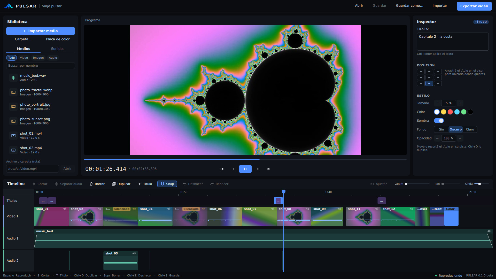
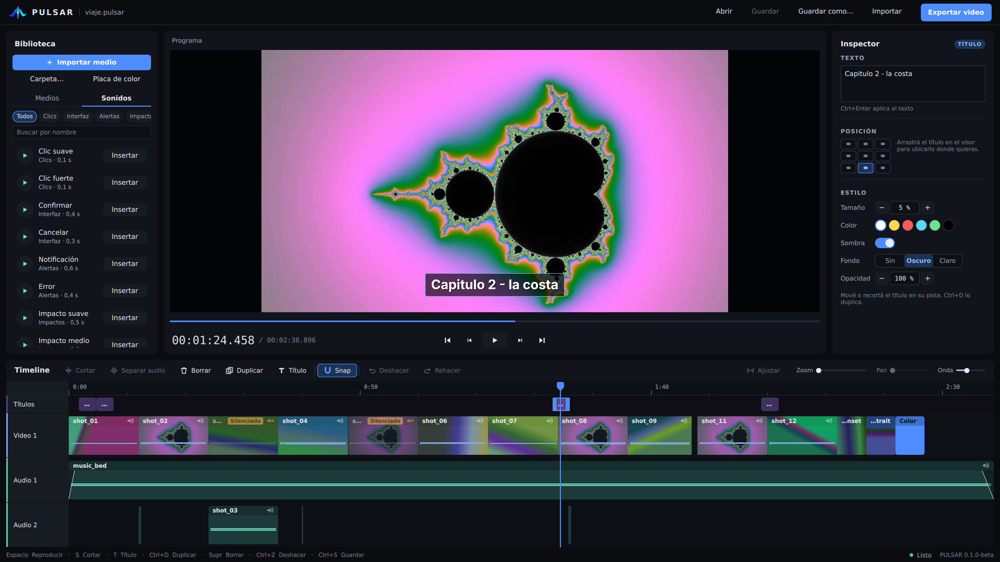

<p align="center">
  
</p>

<h1 align="center">PULSAR</h1>

<p align="center">
  <strong>A native video editor for Linux: local, fast and predictable.</strong><br>
  Import, cut, add titles and sound, and export an MP4 you can upload. No account, no watermark.
</p>

<p align="center">
  
  
  
</p>

<p align="center">
  
</p>

> **Beta.** PULSAR 0.1.0-beta is for people who want to try it on real footage and tell us what is missing.
> The interface is in Spanish. [Español →](README.es.md)

## Why PULSAR

- **Finish a whole video in one tool.** Footage, photos, colour cards, music, sound effects and titles on a multi-track timeline, then export H.264 / AAC.
- **What you see is what you export.** Titles, fades, scaling and audio levels go through the same code in the preview and in the final file; this is checked by tests.
- **Exact and undoable.** Time is exact rational arithmetic, so frame steps and cuts land where you put them, and every edit is one undo step.
- **Safe by default.** Autosave and crash recovery, an audio output stage that cannot clip, projects saved atomically.
- **Light and local.** Native C++ / Qt 6 / FFmpeg, no account and no network access. Projects with 100 clips stay interactive.

## What you can do today

| | |
|---|---|
| **Edit** | Insert at the playhead or add to the end, split, trim, move with magnetic snapping, ripple delete, duplicate, frame step, undo / redo. |
| **Media bin** | Import files or a whole folder, drag clips onto the timeline, thumbnails, filters and search. Video, photos (PNG, JPEG, WebP), colour cards and audio. |
| **Titles** | Text on its own track, size, colour, shadow, optional box and opacity, and **free placement by dragging in the viewer**. |
| **Sound** | Separate audio tracks, detach audio from a video, per-clip gain and mute, **fade in / out**, waveforms and 37 original sound effects you can audition first. |
| **Export** | Original / 1080p / 720p H.264 + AAC in an MP4, with real scaling that never enlarges. |
| **Projects** | Save and reopen `.pulsar` files; recover an unsaved session after a crash. |

<p align="center">
  
  
</p>
<p align="center"><sub>Screenshots use generated test footage.</sub></p>

Not in this beta: Windows / macOS, multiple video tracks, PNG / logo overlays, transitions, effects, subtitles, colour tools,
proxies. The [roadmap](docs/release/roadmap.md) says what comes next and the
[release notes](docs/release/0.1.0-beta.md) list every known limitation.

## Run it

1. Download `PULSAR-0.1.0-beta-linux-x86_64.tar.gz` (or the AppImage) from the Releases page.
2. `tar xzf PULSAR-0.1.0-beta-linux-x86_64.tar.gz && cd PULSAR-0.1.0-beta`
3. `./pulsar`

No Qt or FFmpeg installation is needed. Tested on Ubuntu 24.04; the bundle needs glibc 2.39 or newer.
`./pulsar --version` prints the version. The AppImage needs FUSE 2 or `--appimage-extract-and-run`.

## Try it and tell us

The most useful thing you can do is **edit a real video** and tell us where you got stuck:
[`docs/release/creator-test.md`](docs/release/creator-test.md). Found a bug? Open an issue with the **Bug report** template
(include `./pulsar --version`, your distro, and the steps). Missing something? Use **Feature request**.

## Build from source

Requirements (Ubuntu 24.04 package names): `cmake ninja-build g++ pkg-config`,
Qt 6 (`qt6-base-dev qt6-declarative-dev qt6-multimedia-dev` plus the QML modules
`qml6-module-qtquick qml6-module-qtquick-controls qml6-module-qtquick-dialogs qml6-module-qtquick-layouts qml6-module-qtquick-window qml6-module-qtquick-templates qml6-module-qtqml-workerscript`),
and FFmpeg development files (`libavformat-dev libavcodec-dev libavutil-dev libswscale-dev libswresample-dev`).

```sh
cmake -S . -B build -G Ninja -DCMAKE_BUILD_TYPE=Release -DPULSAR_BUILD_DESKTOP=ON
cmake --build build
ctest --test-dir build --output-on-failure          # QT_QPA_PLATFORM=offscreen on a headless machine
./build/apps/pulsar-desktop/pulsar-desktop
```

Core-only (no Qt/FFmpeg, domain + application tests): add `-DPULSAR_BUILD_FFMPEG=OFF` and
leave `PULSAR_BUILD_DESKTOP` off. Sanitizer build: `-DPULSAR_ENABLE_ASAN=ON -DPULSAR_ENABLE_UBSAN=ON`.
To make a release bundle see [`packaging/linux/README.md`](packaging/linux/README.md).

## Architecture

```text
domain  <-  application  <-  adapters (FFmpeg, Qt audio, project files)  <-  desktop app (Qt Quick)
```

`domain` has no external dependencies (exact rational time, timeline model).
`application` owns commands/undo, project documents, playback coordination, and
the export pipeline without depending on Qt or FFmpeg. See [`docs/architecture`](docs/architecture/README.md)
and the ADRs in [`docs/adr`](docs/adr/README.md).

## Contributing

See [`CONTRIBUTING.md`](CONTRIBUTING.md). The engineering rules are in
[`docs/development/engineering.md`](docs/development/engineering.md), the change history in [`CHANGELOG.md`](CHANGELOG.md).

## License

Not yet specified: the author has to choose a license before the code can be reused by others.
